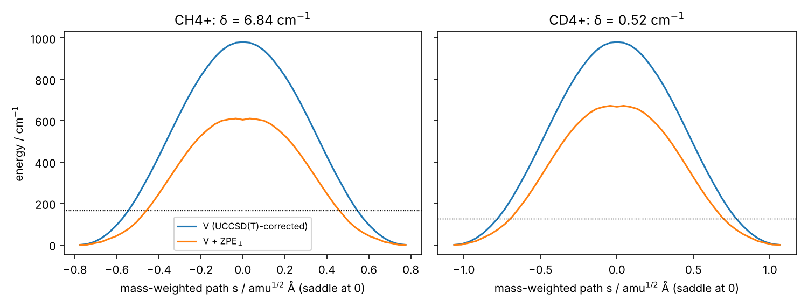
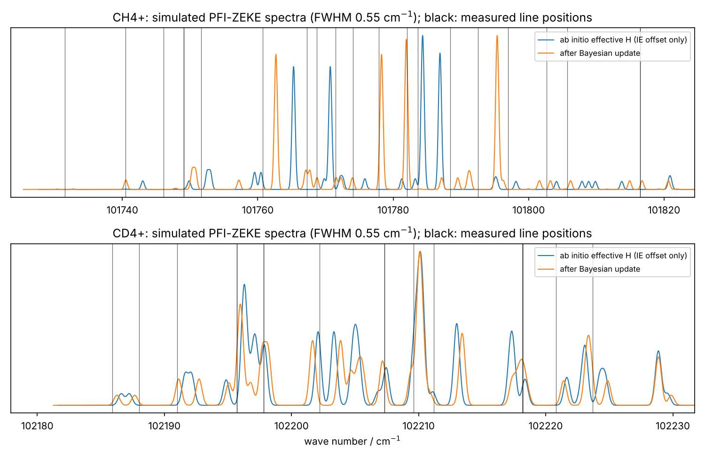
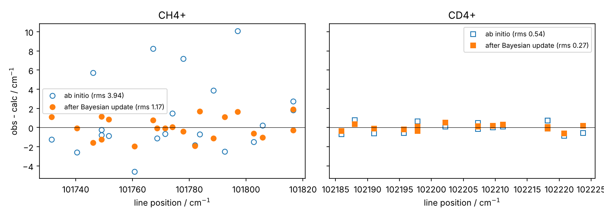

# Case study: CH₄⁺ effective Hamiltonian from the ab initio surface

From the electronic structure of CH₄⁺ alone, this case study computes the constants of the
symmetry-built tunneling–rotation Hamiltonian ([methane_cation.md](methane_cation.md)): A, B, C
and the tunneling matrix element σ (δ = 4|σ|). It then predicts the PFI-ZEKE spectra and compares
them with the measured lines of Wörner, Qian & Merkt, *J. Chem. Phys.* **126**, 144305 (2007).
The ab initio model gets no fitted constants; only the ionization energy is offset. A Bayesian
update then shows how far the data move the ab initio constants.

**Status.** The committed surface is UMP2/cc-pVDZ geometries and Hessians with UCCSD(T)/cc-pVDZ
energies (`data/abinitio/ch4plus_ccpvdz`). The cc-pVTZ surface uses the same pipeline and the same
commands; it is added next to this one when its run finishes.

## Check it yourself

```bash
python scripts/verify_case_studies.py
```

```bash
python scripts/verify_case_studies.py --pdf JCP_126_144305.pdf
```

The first command re-analyses every committed surface from its stage files: geometries,
Hessians, UCCSD(T) points and neutral CH₄. It regenerates the figures and checks each headline
number against `docs/case_studies/expected_results.json`, taking a few seconds. With the paper's
PDF it also extracts the measured lines and repeats the spectrum comparison, the Bayesian update
and the rovibronic fits. The exit status is 0 only if every check passes; currently 27/27 pass
with the PDF and 15/15 without. The line tables are read from your copy of the paper and are not
in the repository.

To recompute the surface itself (PySCF, geomeTRIC, ASE):

```bash
python scripts/abinitio_ch4plus.py --out ch4p --basis cc-pvdz --workers 4
```

```bash
python scripts/case_methane_cation_abinitio.py --abinitio ch4p --pdf JCP_126_144305.pdf --figures figs
```

Run time for the whole cc-pVDZ chain is about 5 minutes on 4 cores; the saddle search takes most
of it. Each stage is cached as `ch4plus_<stage>.json`, and the files in `data/abinitio/` are
exactly these.

## Pipeline and why each step is needed

| Stage | What | Why |
|---|---|---|
| `min` | UMP2 C2v minimum (UHF with stability following) | The six equivalent Jahn–Teller minima give the localized rotor (A, B, C). |
| `ts` | Climbing-image NEB to the *least-motion* neighbouring minimum, then geomeTRIC saddle refinement | δ is set by the lowest path between *adjacent* wells. The neighbour is the permutation-inversion image with the smallest aligned RMSD (0.277 Å), which shares one long C–H bond. Plain transpositions lead to a 5100 cm⁻¹ saddle that is not the tunneling path. |
| `irc` | NEB half path saddle → minimum, cubic refinement, UMP2 energies at 24 points | The reaction coordinate s is the mass-weighted arc length. |
| `hess` | Finite-difference UMP2 Hessians at 12 path points | ZPE of the 8 modes orthogonal to the path (tangent projected out; at the saddle the tangent is the imaginary mode). |
| `ccsdt` | UCCSD(T) at 6 path points, including the saddle and minimum | Corrects the UMP2 profile; MP2 overestimates the barrier by 68 cm⁻¹ here. |
| `neutral` | CH₄ minimum, UMP2 Hessian, UCCSD(T) energy | Adiabatic ionization energy. |

**Saddle validation.** The saddle has exactly one imaginary frequency (560i cm⁻¹), residual
gradient 8 × 10⁻⁷ Eh/Å, and lies 1048 cm⁻¹ above the minimum at UMP2. The UCCSD(T) barrier is
980 cm⁻¹. The paper reports 1014 cm⁻¹ at CCSD(T)/cc-pVTZ, and calls ≈1000 cm⁻¹ the converged
literature value.

**Tunneling model.** The splitting comes from the 1D Hamiltonian
H = −(ħ²/2) d²/ds² + V(s) + ZPE⊥(s) on the mirrored double well (sinc-DVR; `riss_drucker.abinitio.tunneling`).
The lowest pair splits by 2|σ|. The symmetry analysis gives T1 + T2 with the geometric phase,
so δ = 4|σ|. CD₄⁺ uses the same path geometry and Hessians with deuterium masses.



## Results (cc-pVDZ surface)

| | CH₄⁺ ab initio | CH₄⁺ measured (fit) | CD₄⁺ ab initio | CD₄⁺ measured (fit) |
|---|---|---|---|---|
| A / cm⁻¹ | 6.67 | 6.37 ± 0.34 (paper 6.40) | 3.34 | 3.34 ± 0.03 (paper 3.35) |
| B / cm⁻¹ | 5.12 | 5.68 ± 0.24 (paper 5.55) | 2.60 | 2.51 ± 0.04 (paper 2.53) |
| C / cm⁻¹ | 3.70 | 4.12 ± 0.11 (paper 4.03) | 1.87 | 2.00 ± 0.03 (paper 1.98) |
| δ / cm⁻¹ | 6.8 | 17.1 ± 0.5 (paper 16.4) | 0.52 | 1.74 ± 0.25 (paper 1.4) |
| barrier above the tunneling ground level / cm⁻¹ | 447 | — (paper ab initio 399) | 545 | — (paper ab initio 530) |
| spectrum rms, IE offset only / cm⁻¹ | 3.94 (21 lines) | | 0.54 (19 lines) | |
| rms after Bayesian update / cm⁻¹ | 1.17 | 0.94 (free fit) | 0.27 | 0.27 (free fit) |
| δ after Bayesian update / cm⁻¹ | 16.7 | | 1.60 | |

Ab initio ratio δ(CH₄⁺)/δ(CD₄⁺) = 13.2; the free fits give 9.8 (paper 11.7). Adiabatic IE
(UCCSD(T)/cc-pVDZ + harmonic ZPE) = 99 592 cm⁻¹, against 101 752 cm⁻¹ measured. A deficit of
this size, about 2000 cm⁻¹, is typical of a double-zeta basis. This is why the spectrum
comparison offsets the IE and nothing else.

The "measured (fit)" column is our 5-constant fit to the paper's lines
([methane_cation.md](methane_cation.md)). The "paper ab initio" barriers are the electronic
CCSD(T)/cc-pVTZ barrier minus the full harmonic ZPE difference. The comparable quantity here is
the barrier above the 1D ground level, because the path mode is quantized explicitly rather than
treated harmonically.





## Findings and justification

- **Rotational constants come directly from the surface.** A, B and C of the C2v minimum agree
  with the measured effective constants to 5–10% (CD₄⁺ A to 0.1%). The remaining differences
  have two expected causes: equilibrium vs vibrationally averaged constants, and the large
  amplitude of the ground state.
- **The ab initio model alone already predicts the spectrum.** With no constant fitted, the
  predicted CD₄⁺ spectrum matches the 19 measured lines to 0.54 cm⁻¹. That is twice the
  free-fit rms and comparable to the 0.5 cm⁻¹ resolution.
- **δ is predicted to within a factor of 2.5–3, on the correct side.** The 1D model gives δ =
  6.8 (CH₄⁺) and 0.52 cm⁻¹ (CD₄⁺), against 17 and 1.7 measured. The H/D ratio, 13 vs about 10–12,
  is reproduced; it is the cleanest test of tunneling as the mechanism. The underestimate is
  expected, for two reasons:
  1. a 1D minimum-energy path neglects corner cutting, so its splittings are lower bounds;
  2. δ is exponentially sensitive to the effective barrier, including the harmonic ZPE⊥ in a
     strongly anharmonic system: scaling V by 0.9 or 1.1 gives δ = 9.7 or 4.9 cm⁻¹ for CH₄⁺.

  The electronic barrier itself is not the cause: 980 cm⁻¹ here vs 1014 cm⁻¹ at
  CCSD(T)/cc-pVTZ, and a lower barrier makes δ larger, not smaller.
- **ZPE⊥ is essential.** Without the orthogonal zero-point energy, δ falls to 2.2 and
  0.13 cm⁻¹. The modes orthogonal to the path soften at the saddle by about 370 cm⁻¹, which is
  the paper's point that "zero-point effects strongly reduce the size of this barrier".
- **The Bayesian update is a consistency test, not a refit.** Priors are the ab initio values:
  5% on A, B, C and 0.7|σ| + 0.3 cm⁻¹ on σ. Lines carry σ = 0.5 cm⁻¹, and the assignments are
  redone until stable.
  - A and B move by less than 0.5 prior sd; C moves by 0.8 sd (CD₄⁺) and 1.6 sd (CH₄⁺).
  - σ moves by 0.7 sd (CD₄⁺) and 1.6 sd (CH₄⁺), toward the measured δ (16.7 and 1.60 cm⁻¹).
  - Shifts of order 1–2 prior sd mean the ab initio Hamiltonian and the spectrum are compatible
    within the stated model error. The direction of the σ shift matches the known 1D-tunneling
    bias.
  - CD₄⁺ reaches the free-fit rms (0.27 cm⁻¹). CH₄⁺ reaches 1.17 vs 0.94 cm⁻¹: its A, B, C
    differ from the effective values by more than for CD₄⁺ (larger vibrational averaging for H).

## Approximations (stated, not hidden)

- **1D path.** Reaction-path tunneling with adiabatic, harmonic orthogonal modes; no corner
  cutting.
- **Same path for both isotopes.** CD₄⁺ uses the CH₄⁺ minimum-energy path geometry. Exactly,
  the mass-weighted path depends weakly on the isotope.
- **Equilibrium rotational constants.** No vibrational averaging.
- **Correlation.** UMP2 geometries and Hessians, with UCCSD(T) energies interpolated along s.
  T1 diagnostics are not used; the cation is a doublet treated with a UHF reference and
  stability following.
- **Spectrum simulation.** The rotational line strengths use the ΔN-dependent factors of the
  paper's simulations. Only line *positions* are compared quantitatively.

## Letting Claude build the model (`scripts/llm_build_ch4plus.py`)

Above, the model *structure* (six wells with the geometric phase, rotor terms, nearest-well
tunneling) was written by hand. `scripts/llm_build_ch4plus.py` asks Claude to propose it from the
ab initio facts. Claude never supplies a number:

1. **Prompt.** Claude sees the facts (C2v minima, how many there are, the Cs saddle, barrier, σ,
   rigid-rotor constants), the measured line *classes*, the grammar and the Td character table.
   It does not see the hand-built model. It answers with spaces, group, terms and a role per
   term (rotor / tunneling / extra).
2. **Compile and certify.** The library compiles the proposal and certifies hermiticity, time
   reversal, symmetry, counts and the representation. Every failure goes back to Claude
   verbatim in the next round.
3. **Constants from the surface.** Rotor terms are calibrated so the untunneled levels equal the
   ab initio rigid rotor in every well. This works for any normalization the proposal uses.
   Geometry fixes which constant lies along each well's C2 axis, which leaves the B/C swap and
   the sign of σ to the data, as in the hand fit. The tunneling term is set to the ab initio σ.
4. **Score.** Each proposal is scored by:
   - the prediction with only the IE offset;
   - a Bayesian update on A, B, C and σ (a prior of 5% on A, B, C, as above);
   - leave-one-position-out cross-validation.

   The hand-built reference model goes through the identical pipeline. The final model is the
   best by cross-validated rms; the output says whose it is and whether it is equivalent to the
   reference.

Offline tests (`tests/python/test_llm_loop.py`) replay three answers: no JSON, the phase-free
model, and an equivalent model with different names and normalization. The first two are
rejected; the phase-free one fails because "model has no level of class A1 at N+=1", which the
measured J″ = 0 line requires. The third is accepted and reproduces the case-study numbers.

### Running it on your machine (WSL)

Install Claude Code inside the WSL terminal, then log in with your Claude subscription (run
`claude` once and follow the browser prompt):

```bash
curl -fsSL https://claude.ai/install.sh | bash
```

```bash
claude
```

Inspect what Claude will be shown:

```bash
python scripts/llm_build_ch4plus.py --abinitio data/abinitio/ch4plus_ccpvdz --pdf JCP_126_144305.pdf --dry-run | less
```

Run the loop with Claude Code print mode on your subscription. Each round is one `claude -p`
call with tools disabled.

```bash
python scripts/llm_build_ch4plus.py --abinitio data/abinitio/ch4plus_ccpvdz --pdf JCP_126_144305.pdf --llm claude-cli --rounds 4 --figures figs_llm
```

- **API billing instead:** use `--llm api` with `ANTHROPIC_API_KEY` set. With `--llm claude-cli`,
  leave the variable *unset* (otherwise `claude -p` bills the key).
- **Outputs:**
  - `ch4plus_llm_model.json`: the selected spec, constants, scores, and levels up to N⁺ = 5;
  - `ch4plus_llm_transcript.json`: every prompt answer and its feedback.
- **Reproduce a run exactly:** `--llm replay --replay ch4plus_llm_transcript.json`.
- **cc-pVTZ:** point `--abinitio` at `data/abinitio/ch4plus_ccpvtz` once that surface is in.
