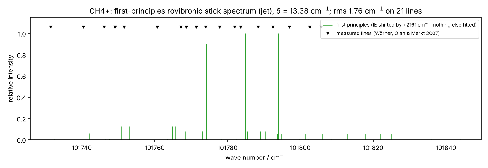
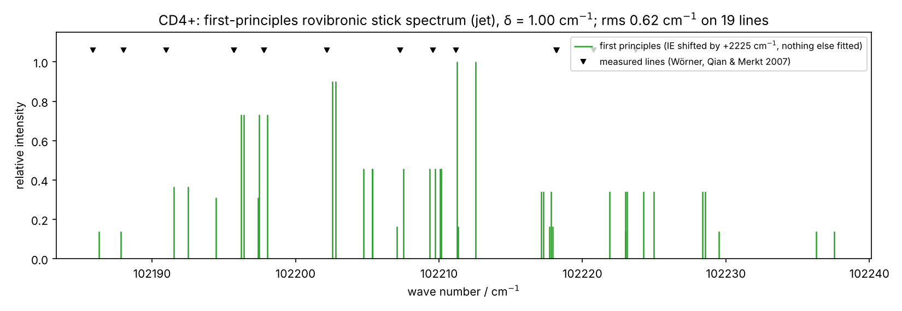
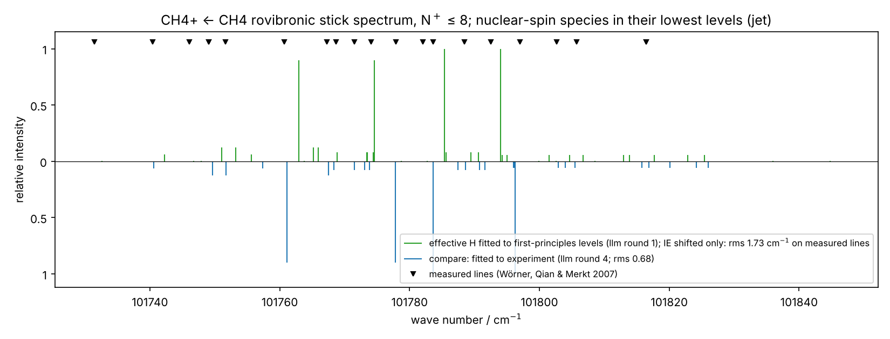

# Case study: CH₄⁺ rovibronic spectrum from first principles

This case study derives the rotation–tunneling Hamiltonian of CH₄⁺ and CD₄⁺ entirely from the ab
initio surface: vibrationally averaged rotor, tunneling splitting and rotation–tunneling
coupling. It then compares the resulting levels with the measured PFI-ZEKE lines of Wörner, Qian &
Merkt, *J. Chem. Phys.* **126**, 144305 (2007).

- **No measured line enters the model.** The only adjustment is a single shift of the ionization
  energy (IE). The ab initio IE is 370–2200 cm⁻¹ too low depending on the basis; that error
  matters for where the band sits, not for its structure.
- **Claude is then scored against these first-principles levels, not experiment.** The measured
  spectrum is used only as an independent check.

Companion pages: [methane_cation.md](methane_cation.md) (symmetry, fits to the measured lines) and
[methane_cation_abinitio.md](methane_cation_abinitio.md) (the ab initio surface, 1D tunneling,
Claude scored against experiment).

## What is computed, and why

| Ingredient | Method (code) | Why it is needed |
|---|---|---|
| Tunneling splitting δ = 4\|σ\| | Variational 2D Schrödinger equation on the **Cartesian reaction plane** of the double well (`abinitio/rpsurface.py`, `tunneling2d.solve_plane`) | The 1D path model misses corner cutting: the path is strongly curved (κ up to 3.4 amu⁻½ Å⁻¹). A Cartesian plane has exact kinetic energy and no coordinate fold. |
| Potential on the plane | UMP2 energies on a lattice (stage `plane2d`), plus [CCSD(T) − MP2] along the path, plus harmonic ZPE of the 7 remaining modes | The valley is strongly anharmonic: ab initio values lie up to 1900 cm⁻¹ below the harmonic estimate off the path. |
| Rotor of one well | ⟨I⁻¹⟩ averaged over the localized tunneling ground state ψ_L = (ψ₀ + ψ₁)/√2 | Equilibrium constants are not what a floppy molecule shows. |
| Rotation–tunneling coupling | Frame rotation R_θ accumulated along L → saddle → R in the zero-angular-momentum frame; the hop carries D(R_θ) | The molecule-fixed frame of a neighbouring well differs from the transported frame by a rotation of θ = 10.4–10.7°. |
| Sign of σ | Ham's theorem: the N⁺ = 0 vibronic ground state has the electronic symmetry (F2) | Fixes which tunneling component is lower, with no data. |
| Well labelling | Hole function along the long-bond H–H direction | Verified from the UHF wavefunction: the unoccupied β orbital's carbon-p direction has overlap 1.000 with the long-pair H–H direction and 0.000 with the short pair; the spin density sits on the long-bond H atoms (0.148 each). |

The rovibronic Hamiltonian is assembled with the builder's own operators
(`firstprinciples.rovibronic_levels`):

H = n_w/|G| Σ_g U_g (|L⟩⟨L| ⊗ Q·JJ) U_g† + s σ/c₀ · 1/|G| Σ_g U_g (|R⟩⟨L| ⊗ D(R_θ) + h.c.) U_g†

It is projected onto the compiled Td symmetry blocks. The rotation-operator convention
D J D† = R·J holds to 10⁻¹⁶, and the off-block remainder is below 10⁻¹⁵.

## Convergence and checks

| Check | Result |
|---|---|
| Plane solver, separable limit (double well × oscillator) | matches the 1D sinc-DVR splitting to 10⁻⁴ |
| Plane potential along the path | equals the folded 1D profile exactly |
| Path energies recomputed on the plane | within 5–9 cm⁻¹ (kernel-smoothed relaxation of the other coordinates) |
| Solver grid h = 0.014 → 0.010 → 0.007, h² extrapolation | change in the last step < 0.3% |
| Ab initio lattice spacing 0.04 → 0.03 → 0.022 (cc-pVDZ) | δ(CH₄⁺) 13.378 → 13.375 → 13.374; δ(CD₄⁺) 1.000 → 0.998 → 0.999 |
| Tunneling density on computed points | 100% (points beyond each minimum are reflected into the path region, as in the 1D mirror) |
| Frame-rotation convention (derived, not fitted) | CH₄⁺: lower rms than inverted or none at both bases (weak evidence, see Findings); CD₄⁺: differences of 0.01–0.03 cm⁻¹, i.e. no evidence either way |

## Results

Values are in cm⁻¹ except the frame rotation. Validation means rms against the measured lines (21
for CH₄⁺, 19 for CD₄⁺), with only the IE shifted.

| | cc-pVDZ, ab initio plane | cc-pVTZ, ab initio plane | Measured |
|---|---|---|---|
| δ CH₄⁺ | 13.4 | 13.1 | 17.1 (fit), 16.4 (paper) |
| δ CD₄⁺ | 1.00 | 0.91 | 1.74 (fit), 1.4 (paper) |
| CH₄⁺ A, B, C (averaged) | 6.47, 5.18, 3.68 | 6.70, 5.31, 3.77 | 6.37, 5.68, 4.12 |
| CD₄⁺ A, B, C (averaged) | 3.27, 2.63, 1.86 | 3.38, 2.70, 1.91 | 3.34, 2.51, 2.00 |
| Frame rotation per hop | 10.38° / 10.44° | 10.59° / 10.65° | — |
| IE shift applied (validation only) | +2161 / +2225 | +371 / +435 | — |
| **Validation, CH₄⁺** | 1.76 | 1.83 | 0.94 (free 5-constant fit) |
| **Validation, CD₄⁺** | 0.62 | 0.63 | 0.27 (free fit) |
| Same, frame rotation inverted (CH₄⁺ / CD₄⁺) | 2.68 / 0.66 | 2.39 / 0.66 | — |
| Same, no frame rotation (CH₄⁺ / CD₄⁺) | 2.00 / 0.64 | 2.06 / 0.65 | — |

δ from each tunneling model on the cc-pVDZ surface (δ = 2 × pair splitting):

| Model | CH₄⁺ | CD₄⁺ |
|---|---|---|
| 1D path (adiabatic, harmonic ZPE) | 4.8 | 0.40 |
| Curvilinear 2D reaction-path Hamiltonian (a lower bound: the coordinates fold at 1/κ) | 6.5 | 0.60 |
| Cartesian plane, harmonic valley | 9.1 | 0.85 |
| **Cartesian plane, ab initio (UMP2 + path CCSD(T))** | **13.4** | **1.00** |
| Small-curvature effective mass (an overestimate at κt ≈ 0.5) | 30 | 3.5 |

**Findings.**
- **Corner cutting and anharmonicity together** raise the first-principles δ(CH₄⁺) from 4.8 to
  13.4 cm⁻¹ (cc-pVDZ) and from 4.2 to 13.1 cm⁻¹ (cc-pVTZ), about 80% of the measured
  16.4–17.1 cm⁻¹, with nothing fitted. The larger basis moves δ slightly *away* from experiment,
  so the remaining gap is not a basis-set artifact.
- **The 20% gap is within the method's own sensitivity.** δ depends exponentially on the barrier
  and the zero-point energy: in the 1D model a ±10% change of V moves δ by a factor of two, so
  13.1 vs 17 corresponds to a few percent in the effective barrier. The uncertainty budget
  (`scripts/review_followups.py budget`) quantifies this; until it is read, the agreement should be
  taken as "right magnitude", not as a precise prediction.
- **The predicted spectrum improves accordingly.** CH₄⁺ goes from 4.1 cm⁻¹ rms (equilibrium
  constants, 1D tunneling) to 1.76 / 1.83 cm⁻¹ rms (cc-pVDZ / cc-pVTZ), against 0.94 for a free
  5-constant fit. CD₄⁺ is 0.62 / 0.63 cm⁻¹. The free fits themselves are not at the 0.5 cm⁻¹ line
  σ used throughout: at σ = 0.5 their χ²/dof is ≈ 4.6 (CH₄⁺) and ≈ 0.4 (CD₄⁺), and held-out
  coverage (`review_followups.py coverage`) shows the CH₄⁺ lines behave as if σ ≈ 1.1 cm⁻¹.
- **Vibrational averaging improves A** for both isotopologues (cc-pVDZ, CH₄⁺: equilibrium 6.67 →
  averaged 6.47; measured 6.37).
- **The frame rotation: suggestive for CH₄⁺, untested for CD₄⁺.** For CH₄⁺ the derived convention
  gives 1.76 / 1.83 cm⁻¹ against 2.00–2.68 without or inverted. With σ ≈ 1.1 cm⁻¹ (not 0.5) and
  lines that share upper levels, that is a Δχ² of order a few, not a decisive test. For CD₄⁺ the
  three variants differ by 0.01–0.03 cm⁻¹ at 0.5 cm⁻¹ resolution: no evidence either way. The
  convention was derived, not fitted, but "the data prefer it" is too strong.
- **The remaining gaps:** δ(CH₄⁺) is 20% low, and B and C are 5–10% off. These are consistent with
  the approximations below, but "consistent with" is not a demonstration: see the budget.





## Claude scored against first principles (data-free mode)

`scripts/llm_build_ch4plus.py --target firstprinciples --fp ch4plus_firstprinciples_<basis>.json`
scores each proposal this way:
1. compile and certify it;
2. fit its coefficients to the first-principles levels with N⁺ ≤ 5 (90 levels per isotopologue);
3. score it by the rms of the *predicted* levels N⁺ = 6–8 (112 levels).

The measured lines only validate. Replaying Claude's two physically motivated proposals from the
experimental run on the cc-pVDZ first-principles levels gives:

| Model | Score (predicted N⁺ 6–8, mean) | CH₄⁺ fit / predicted | CD₄⁺ fit / predicted | Validation CH₄⁺ / CD₄⁺ |
|---|---|---|---|---|
| Reference (rotor + σ) | 0.718 | 1.30 / 1.35 | 0.080 / 0.088 | 2.03 / 0.64 |
| **Claude round 3** (+ J-dependent tunneling, 2 first-order rotation–tunneling couplings, opposite-well coupling) | **0.350** (selected) | 0.29 / 0.65 | 0.017 / 0.046 | 1.73 / 0.62 |
| Claude round 4 (+ one Coriolis term J·L) | 0.548 | 0.73 / 1.03 | 0.049 / 0.066 | 1.80 / 0.62 |

**This scoring is partly circular.** The first-principles levels come from a Hamiltonian that
contains the frame-rotation operator exp(−iθ n·J), so proposals that contain its expansion win by
construction. The live run on the cc-pVTZ levels (Opus, 4 calls) shows this directly: Claude was
given θ and n in the prompt and wrote the Taylor series of exp(−iθ n·J) into the hop terms,
reproducing the target to 0.0003 cm⁻¹ rms (reference 0.70). That shows it can read and encode the
physics it is given. It is not evidence that it discovered anything, and it does not improve the
match to experiment: 1.82 / 0.633 cm⁻¹, the same as the first-principles levels themselves
(1.83 / 0.633). On experiment, the replayed models in the table move the validation from 2.03 to
1.73 cm⁻¹ (CH₄⁺) and 0.64 to 0.62 cm⁻¹ (CD₄⁺), small compared with σ ≈ 1.1 / 0.5 cm⁻¹.

A dictionary baseline (every symmetry-allowed rotation–tunneling term, greedy forward selection,
no language model) scored exactly the same way is in `scripts/review_followups.py baselines`. In
experiment mode the prompt also lists the observed line classes, and Claude has very likely read
the published geometric-phase analysis, so its proposing that structure is not independent
evidence either.



Upper sticks: the effective Hamiltonian fitted to first-principles levels. Lower sticks: the model fitted
to the measured lines. Markers: measured positions. Full line lists are in the `*.csv` files next to
each figure.

## Approximations

- **Two explicit coordinates.** The path and its in-plane transverse direction hold 99% of the
  path's mass-weighted motion. The other 7 modes enter as harmonic adiabatic zero-point energy
  from the path Hessians.
- **The plane is MP2.** The CCSD(T) correction is applied as a function of the path coordinate
  only.
- **Pairwise tunneling.** The six-well topology enters through symmetry and nearest-well hops
  (δ = 4|σ|). Beyond each minimum the potential is the mirror image, as in the 1D model.
- **The CD₄⁺ plane is built on the same path geometries,** with deuterium mass weighting.
- **Rotor averaging covers the two plane coordinates only.**
- **Electron spin is not resolved;** intensities use ΔN propensities, not a photoionization
  calculation.

## Running it

At cc-pVTZ, the reaction plane is about 4,900 UMP2 single points, roughly an hour on a 20-core
workstation; all earlier stages are reused. Run it in the background, so it continues after the
SSH session closes:

```bash
scripts/ch4plus_background.sh start --basis cc-pvtz --pdf JCP_126_144305.pdf --llm --commit
```

```bash
scripts/ch4plus_background.sh status --basis cc-pvtz
```

The individual steps:

```bash
python scripts/abinitio_ch4plus.py --out ch4p --basis cc-pvtz --workers 5 --stages plane2d
```

```bash
python scripts/firstprinciples_ch4plus.py --abinitio data/abinitio/ch4plus_ccpvtz --pdf JCP_126_144305.pdf --out fp.json --figures figs
```

```bash
python scripts/llm_build_ch4plus.py --abinitio data/abinitio/ch4plus_ccpvtz --target firstprinciples --fp fp.json --pdf JCP_126_144305.pdf --llm claude-cli --rounds 4 --max-budget-usd 2
```

To check the recorded numbers (about 2 min extra). The verifier compares against values this same
code produced earlier: it proves reproducibility, not correctness.

```bash
python scripts/verify_case_studies.py --pdf JCP_126_144305.pdf --firstprinciples
```

## Any molecule

The loop itself is molecule-independent (`riss_drucker.llm_loop`). The adapter
`riss_drucker.llm_adapters.LevelsAdapter` takes:
- any `Molecule` (geometry → point group, Γ_vib, spin weights, certified zeroth-order plan);
- any list of target levels {J, irrep, E}, for example from a variational ab initio calculation,
  a catalogue or experiment.

It fits proposals to the levels with J ≤ jfit and scores them by prediction of J > jfit. The test
`tests/python/test_llm_generic.py` runs this for water: it rejects a time-reversal-odd term, selects
the quartic distortion term because it extrapolates, and recovers its coefficient exactly.
